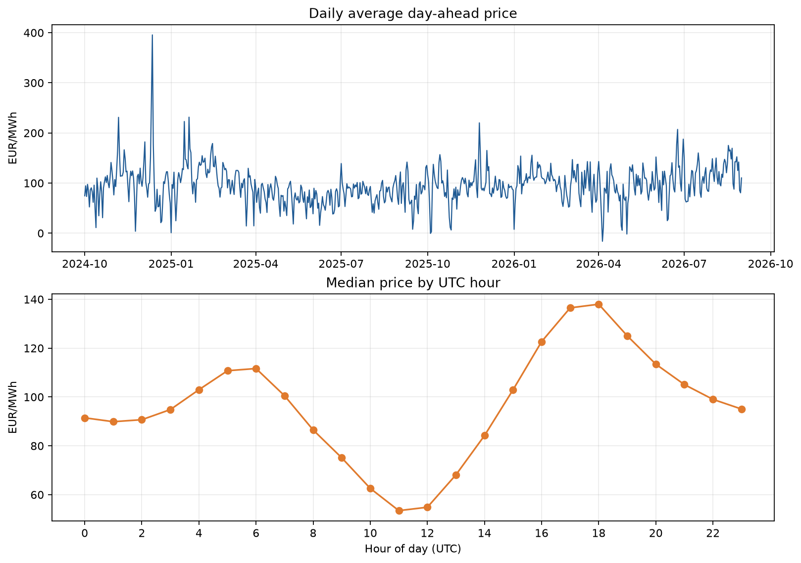
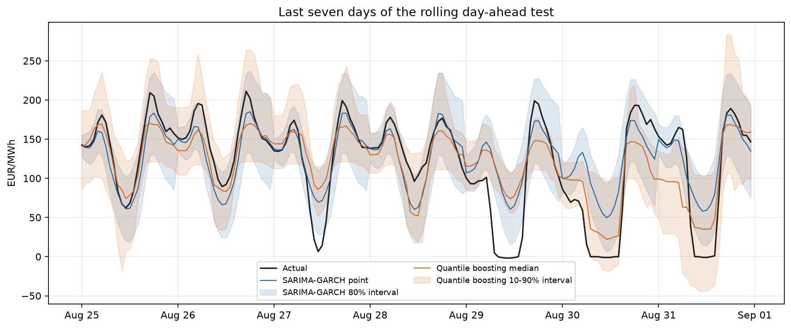

# Beyond a Single Price: Day-Ahead Electricity Forecasts with SARIMA-GARCH and Quantile Boosting

*How a time-series forecast can show both the expected price and the uncertainty energy planners need to see.*

Electricity is unusual: supply and demand must stay balanced, storage is limited, and prices can change sharply within a day. For a supplier scheduling purchases or a facility deciding when to shift electricity use, knowing only “tomorrow’s price” is not enough. It is also useful to know whether that forecast is relatively certain or whether a much higher or lower price is plausible.

This project studies that problem using hourly day-ahead prices from the German-Luxembourg (DE-LU) bidding zone. It compares a seasonal SARIMA model combined with GARCH volatility estimates against quantile gradient boosting. The purpose is not to promise perfect prices, but to demonstrate a transparent way to compare point forecasts and prediction intervals on real market data.

## What makes electricity prices difficult to forecast?

Electricity prices have patterns at several time scales. Prices at the same hour on consecutive days can be related; weekends may differ from weekdays; and the typical price level can change over months. Unexpected supply or demand conditions can also produce sharp spikes or negative prices. A model that predicts an average pattern may miss these sudden movements.

SARIMA—Seasonal Autoregressive Integrated Moving Average—is a statistical model for repeating patterns in a time series. In this experiment, SARIMA(1,0,1) × (1,0,1,24) represents hourly prices, with a seasonal period of 24 hours. Its point forecast models the expected price using recent prices and the daily cycle.

GARCH, or Generalized Autoregressive Conditional Heteroskedasticity, models how forecast-error variance changes over time. In plain language, uncertainty can grow after large price movements and fall during calmer periods. A simple GARCH(1,1) variance equation is:

`σ²ₜ = ω + αε²ₜ₋₁ + βσ²ₜ₋₁`

Here, `σ²ₜ` is the current estimated error variance, `εₜ₋₁` is the previous forecast error, and `ω`, `α`, and `β` are estimated from historical errors. SARIMA supplies the mean forecast; GARCH supplies changing uncertainty around it. The resulting interval is useful only if actual prices fall inside it often enough and its width is practical.

## A second approach: forecast the quantiles directly

Quantile Gradient Boosting answers a different question: instead of predicting only a mean and adding a distribution-based interval, it learns several parts of the conditional price distribution directly. Three models estimate the 10th percentile, median (50th percentile), and 90th percentile. The 10th-to-90th-percentile range is an approximate 80% prediction interval. The median is used as the point forecast.

The features include prices 24, 48, and 168 hours earlier, rolling statistics, and calendar cycles for hour, weekday, and month. Importantly, the features for a target day use only prices available at least 24 hours before that day begins. That avoids using tomorrow’s actual price to predict tomorrow.

## Dataset and experiment

The data come from the public Energy-Charts price API for the DE-LU market, attributed to Bundesnetzagentur/SMARD under CC BY 4.0. The hourly series covers 1 October 2024 to 31 August 2026: 700 complete days. The source changed to 15-minute observations in October 2025, so those observations are averaged to hourly prices. All timestamps are in UTC, and prices are in EUR/MWh.

The first 180 days are kept for initial model training. The remaining 520 days—from 30 March 2025 to 31 August 2026—form a chronological, rolling day-ahead test. Each forecast covers the next 24 hours; actual prices enter the model history only after that day’s forecast has been produced. This is a more realistic test than randomly mixing past and future observations.



*Figure 1. Exploratory analysis of the real DE-LU hourly dataset. Upload this image from `outputs/eda.png` when publishing.*

## What did the comparison show?

Over the full 520-day test, SARIMA-GARCH achieved a mean absolute error (MAE) of **€23.28/MWh** and a root mean squared error (RMSE) of **€36.38/MWh**. Quantile boosting achieved an MAE of **€25.11/MWh** and an RMSE of **€38.27/MWh**. On these point-error measures, SARIMA-GARCH performed better.

For intervals, the nominal target is 80% coverage: ideally, about 80 out of every 100 actual prices fall between the lower and upper bounds. SARIMA-GARCH coverage was **82.9%**, with an average interval width of **€83.25/MWh**. Quantile boosting coverage was **79.8%**, with an average width of **€81.90/MWh**. Thus, the quantile model was close to the 80% target and produced a slightly narrower interval, while SARIMA-GARCH had lower point error. Neither result proves that one model is best for every market or season.



*Figure 2. Recent actual prices, point forecasts, and uncertainty intervals. Upload `outputs/forecast_comparison.png` when publishing.*

## Reproduce the forecast plot

After running the project to generate `outputs/backtest_predictions.csv`, this short example plots a selected UTC test day. The columns contain actual prices, model forecasts, and lower and upper interval bounds:

```python
import pandas as pd
import matplotlib.pyplot as plt

forecasts = pd.read_csv(
    "outputs/backtest_predictions.csv",
    parse_dates=["timestamp_utc"],
)

day = forecasts[
    forecasts["timestamp_utc"].dt.strftime("%Y-%m-%d") == "2026-08-31"
]

plt.plot(day["timestamp_utc"], day["actual"], label="Actual")
plt.plot(day["timestamp_utc"], day["qgb_forecast"], label="Quantile median")
plt.fill_between(
    day["timestamp_utc"],
    day["qgb_lower"],
    day["qgb_upper"],
    alpha=0.2,
    label="Quantile 80% interval",
)
plt.ylabel("EUR/MWh")
plt.legend()
plt.tight_layout()
plt.show()
```

## Why uncertainty matters—and what remains to improve

For an energy buyer, a forecast interval can help compare a fixed-price contract with exposure to market prices. A storage operator can use likely high-price hours to consider discharge timing; a large consumer can plan flexible demand. These are decision-support examples, not guarantees that a forecast will save money. Real decisions also depend on operating constraints, market rules, and the cost of forecast errors.

This is a focused student experiment, not a complete market-trading system. It models one bidding zone and does not include weather, electricity demand, renewable generation, fuel costs, or cross-border flows. Its 24-hour horizon is defined in UTC, so it is not always identical to a local-market day around daylight-saving changes. The test period also represents one historical market path. Future work could add external predictors, compare multiple seasons and zones, calibrate intervals, and test whether the forecasts improve a clearly defined operational decision.

The main lesson is simple: evaluate both the predicted price and the uncertainty around it. A useful forecasting project should show how it was tested, how often its intervals contained the truth, and where its assumptions stop.

## References

1. Weron, R. (2014). “Electricity price forecasting: A review of the state-of-the-art with a look into the future.” *International Journal of Forecasting*, 30(4), 1030–1081. https://doi.org/10.1016/j.ijforecast.2014.08.008
2. Nowotarski, J., & Weron, R. (2018). “Recent advances in electricity price forecasting: A review of probabilistic forecasting.” *Renewable and Sustainable Energy Reviews*, 81, 1548–1568. https://doi.org/10.1016/j.rser.2017.05.234
3. Lago, J., Marcjasz, G., De Schutter, B., & Weron, R. (2021). “Forecasting day-ahead electricity prices: A review of state-of-the-art algorithms, best practices and an open-access benchmark.” *Applied Energy*, 293, 116983. https://doi.org/10.1016/j.apenergy.2021.116983
4. Bundesnetzagentur/SMARD. Energy-Charts price API, DE-LU bidding zone, CC BY 4.0. https://api.energy-charts.info/
